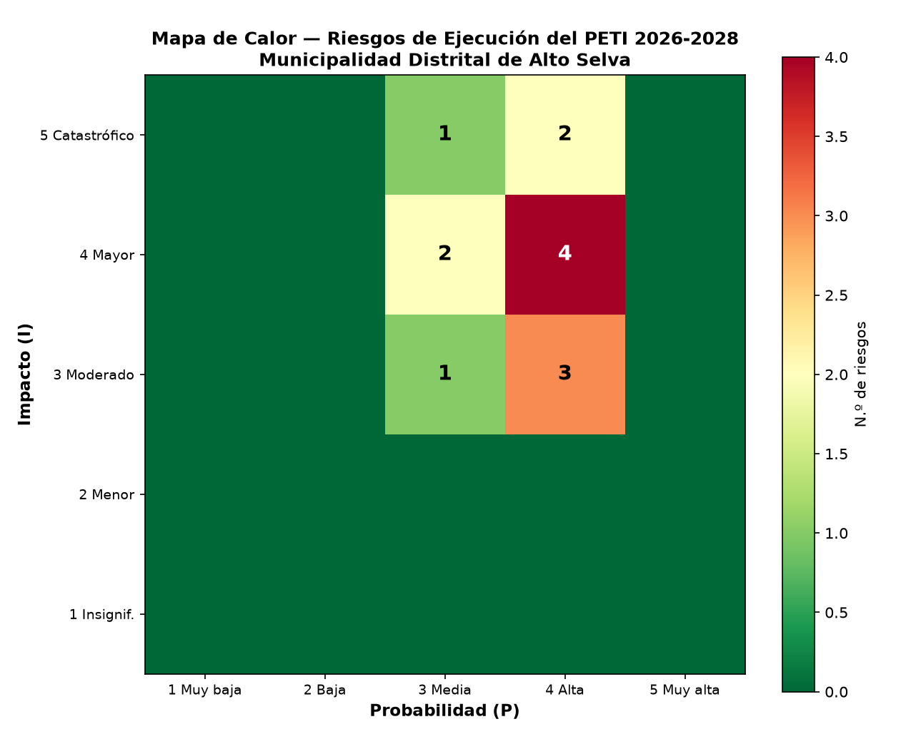

# PETI 2026–2028: Gestión de Riesgos del Plan y Matriz de Comunicación
**Organización:** Municipalidad Distrital de Alto Selva (Empresa 03)  
**Curso:** SI-886 Planeamiento Estratégico de Tecnologías de Información — Sec. A  
**Institución:** Escuela Profesional de Ingeniería de Sistemas — Universidad Privada de Tacna  
**Docente:** Dr. Oscar Juan Jimenez Flores  
**Autor:** Choqueña Choque Mauricio Arian · 2023076799  
**Versión del Plan:** `v0.15` | **Etiqueta del Taller:** `taller-15`  

---

## 📌 Descripción del Proyecto
Este repositorio contiene la formulación completa de la **Sección 8 del Plan Estratégico de Tecnologías de la Información (PETI 2026–2028)** para la **Municipalidad Distrital de Alto Selva**, desarrollada en el marco del Taller de Laboratorio de la Semana 15.

El trabajo se fundamenta en la norma internacional **ISO 31000:2018**, el estándar de seguridad **ISO/IEC 27005:2022** y los lineamientos de gobernanza de la Secretaría de Gobierno y Transformación Digital (**PCM-SGTD** / D.L. 1412), abordando de manera trazable y cuantitativa las amenazas a la ejecución de la hoja de ruta digital municipal.

---

## 📂 Estructura del Repositorio

```text
peti/
├── 08_riesgos/
│   ├── RG01_contexto.md          # Alcance, horizonte de 3 años, escalas 1-5 operativas y criterios acordados
│   ├── RG02_registro.csv         # 13 riesgos en las 9 categorías (Evento + Causa + Consecuencia)
│   ├── RG03_evaluacion.py        # Script Python de valoración cuantitativa (P × I) y categorización
│   ├── RG03_evaluado.csv         # Registro evaluado con valor inherente y nivel de riesgo
│   ├── RG04_tratamiento.csv      # Plan de tratamiento, cargo responsable, residual y señales tempranas
│   ├── RG05_residual.py          # Script de análisis de reducción del riesgo y residuales > 6
│   ├── RG06_comunicacion.csv     # Matriz de comunicación de 8 columnas (incluye sesión previa de aprobación)
│   └── 08_seccion_peti.md        # Redacción formal de la Sección 8 del PETI (subsecciones 8.1 a 8.9)
├── graficos/
│   └── RG_mapa_calor.png         # Mapa de calor de riesgos 5x5 generado automáticamente
├── evidencias/S15/salidas/
│   ├── RG03_salida.txt           # Log de ejecución de evaluación y detección de riesgos >= 15
│   └── RG05_salida.txt           # Log de análisis residual (reducción del 55 % y 0 omisiones de señales)
├── EMPRESA-03-municipalidad-alto-selva/
│   ├── bia.csv                   # Análisis de impacto al negocio de procesos municipales
│   ├── politica-de-respaldo.md   # Política POL-TI-007 y auditoría de prácticas reales
│   └── universo-auditable-y-riesgos.md # 17 entidades auditables y riesgos históricos
├── SI886-S15-TALLER-Grupo3.docx  # Informe técnico oficial en formato Word editable
├── SI886-S15-TALLER-Grupo3.pdf   # Informe técnico oficial exportado en PDF (18 páginas)
└── README.md                     # Documentación principal del repositorio
```

---

## 📊 Síntesis de Resultados y Gobernanza del Riesgo

### 1. Evaluación Inherente
- **Riesgos Evaluados:** 13 riesgos cubriendo el 100 % de las 9 categorías obligatorias más el riesgo transversal de ejecución.
- **Distribución:**
  - **Crítico ($\ge 15$):** 7 riesgos (R-08, R-12, R-01, R-03, R-05, R-07, R-02). *Requieren decisión formal previa de Alcaldía y Gerencia Municipal.*
  - **Alto ($12 - 14$):** 5 riesgos (R-04, R-06, R-09, R-10, R-11).
  - **Medio ($7 - 11$):** 1 riesgo (R-13).
  - **Bajo ($\le 6$):** 0 riesgos.

### 2. Mapa de Calor (Matriz 5 × 5)


### 3. Efectividad del Tratamiento y Riesgo Residual
- **Exposición Inicial Agregada:** 190 puntos.
- **Exposición Residual Agregada:** 86 puntos.
- **Reducción Neta:** **104 puntos (55 % de reducción del riesgo)**.
- **Señales Tempranas:** 100 % de los riesgos cuentan con señal observable y umbral cuantitativo (`0 riesgos sin señal`).
- **Residuales sobre el Criterio ($>6$):** 6 riesgos con valor residual 8, con responsabilidad de aceptación formal asignada por cargo institucional (Alcaldía y Gerencia Municipal).

---

## 🚀 Instrucciones de Ejecución

Para replicar los cálculos matemáticos y generar los gráficos:

```bash
# 1. Clonar el repositorio
git clone https://github.com/KrCrimson/SI886-PETI-Grupo3.git
cd SI886-PETI-Grupo3

# 2. Instalar dependencias
pip install pandas numpy matplotlib python-docx

# 3. Ejecutar la evaluación inherente y generar el mapa de calor
cd 08_riesgos
python RG03_evaluacion.py

# 4. Ejecutar el análisis de reducción y residuales
python RG05_residual.py
```

---

## 🏷️ Etiquetas de Versión (Git Tags)
- **`taller-15`:** Marca el commit exacto calificado para la entrega del Taller de la Semana 15.
- **`v0.15`:** Marca el estado de madurez de la Sección 8 del PETI.
